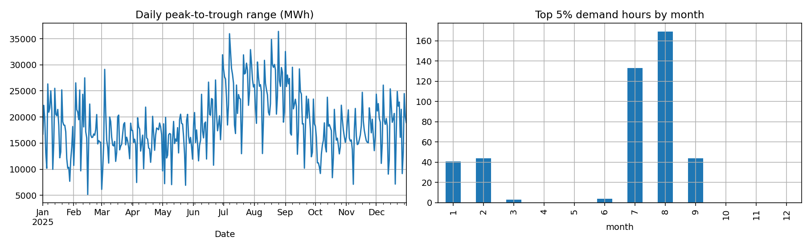
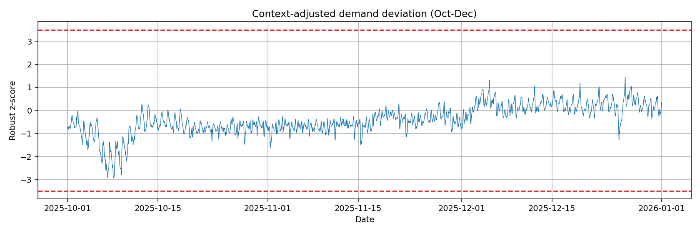
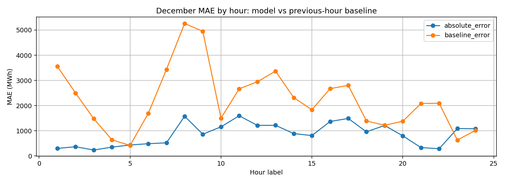

# Electricity Demand Analysis ⚡

**2025년 전국 전력수요 데이터 분석 | 수요가 몰리는 시기와 변화 패턴, 다음 1시간 수요 예측**

한국전력거래소(KPX)의 2025년 전국 시간별 전력수요 공공데이터를 이용해 **전력수요가 많은 시기**, **시간별 수요 변화**, **평소 같은 요일·시간대와 다른 패턴**을 분석했습니다. 또한 과거 데이터를 이용해 머신러닝 모델로 **다음 1시간의 전력수요를 예측**하고, 전력수요를 지속적으로 살펴볼 때 참고할 수 있는 지표를 정리했습니다.

**Tech Stack** · Python · Pandas · NumPy · Matplotlib · scikit-learn · Google Colab

[분석 코드 및 결과 확인](Electricity_Demand_Analysis.ipynb) · [데이터 출처(공공데이터포털)](https://www.data.go.kr/data/15065266/fileData.do)

## 한눈에 보는 결과

| 분석 항목 | 주요 결과 |
|:--|:--|
| 분석 범위 | **2025년 365일 · 8,760시간** |
| 월평균 수요가 가장 높은 달 | **8월** |
| 평균 수요가 가장 높은 시간대 | 원본 데이터의 **19시** 항목 |
| 상위 5% 수요 집중 | **8월 169시간**, 원본 데이터의 **17시·18시** 항목에서 각각 55시간으로 공동 최다 |
| 하루 중 최대·최소 수요 차이가 가장 큰 날 | **36,397 MWh** (2025-08-25) |
| 평일 / 주말 평균 수요 | **66,920.9 / 58,435.9 MWh** |
| 평소 패턴과 크게 다른 수요 | 10~12월 **2,208시간 중 0시간** (설정한 통계 기준) |
| 12월 최종 예측 | **Hist Gradient Boosting · MAE 736.574 MWh · R² 0.984** |

> **참고:** 여기서 말하는 높은 수요, 급격한 변화, 평소와 다른 패턴은 데이터 분석을 위한 기준입니다. 실제 정전 위험이나 전력설비 고장을 판정한 결과는 아닙니다.

## 주요 시각화

### 01. 전력수요가 특히 높았던 시기와 하루 중 변화 폭



전체 8,760시간 중 수요가 가장 높았던 **상위 5%(438시간)**를 살펴봤습니다. 이 구간의 기준은 **82,947.2 MWh 이상**이며, **8월에 169시간**으로 가장 많이 나타났습니다. 또한 하루의 최대 수요와 최소 수요 차이를 계산해 하루 동안 수요가 얼마나 달라졌는지도 확인했습니다.

### 02. 한 시간 사이 전력수요가 얼마나 변했을까?


한 시간 전과 비교해 수요가 얼마나 늘거나 줄었는지 계산하고, **시간대별 대표적인 변화 크기(중앙값)**를 비교했습니다. 수요가 빠르게 변했다고 해서 반드시 문제가 발생한 것은 아닙니다.

### 03. 평소 같은 요일·시간대와 다른 수요가 있었을까?



**1~9월** 데이터를 이용해 요일과 시간대별 평소 수요 수준을 계산하고, **10~12월 2,208시간**의 수요가 그 수준에서 크게 벗어났는지 확인했습니다. 중앙값과 MAD(중앙절대편차)를 활용한 통계 기준(`|robust_z| ≥ 3.5`)에서 **해당 시간은 0건**이었습니다. 임계값 2.0에서는 49시간, 2.5에서는 23시간이 탐지되었습니다. **1~9월을 한꺼번에 사용한 MAD는 계절 차이로 둔감할 수 있으며, 공휴일도 반영하지 않았습니다.** 이 결과만으로 실제 이상 현상이 없었다고 판단할 수는 없습니다.

### 04. 시간대에 따라 예측이 얼마나 정확했을까?



12월 데이터를 대상으로 **Hist Gradient Boosting 모델**과 **직전 시간의 수요를 그대로 예측값으로 사용하는 기본 방법**을 비교했습니다. 시간대별로 실제 수요와 예측값이 얼마나 차이 나는지도 살펴봤습니다.

## 사용한 데이터와 정리 과정

| 항목 | 내용 |
|:--|:--|
| 제공기관 | 한국전력거래소(KPX) |
| 데이터 | [시간별 전국 전력수요량](https://www.data.go.kr/data/15065266/fileData.do) |
| 기간 / 단위 | 2025-01-01 ~ 2025-12-31 / MWh |
| 원본 형식 | 날짜 열 + `1시`~`24시` 열, CP949 인코딩 |
| 전처리 | 마지막 빈 행 제거, 날짜·수요값 형식 정리, 빠지거나 중복된 데이터 확인, 시간별 행으로 재구성 |
| 검증 | 365일 × 하루 24개 시간대 = **8,760개 시간별 데이터** |
| 데이터 범위 주의 | 전국 시간별 집계이며 육지·제주 포함 범위와 잠정자료 여부는 제공기관 원본 안내를 기준으로 확인 필요 |

원본 CSV의 수요값은 변경하지 않았습니다. 날짜별로 나뉘어 있던 `1시`부터 `24시`까지의 값을 **한 행에 한 시간대의 수요가 들어가도록** 정리했습니다. 분석 과정에서는 시간 표시를 계산용 날짜·시간 값으로 변환했으며, **원본 `1시`~`24시`가 가리키는 정확한 집계 시간은 제공기관의 설명을 기준으로 해석해야 합니다.**

## 머신러닝: 1시간 앞 수요 예측

### 실험 설계

- **목표:** 과거 수요와 날짜·시간 정보를 이용해 다음 1시간의 수요 예측
- **특성:** 직전 시간 수요(`lag_1`), 전날 같은 시간 수요(`lag_24`), 일주일 전 같은 시간 수요(`lag_168`), 시간·요일·월 정보
- **시간순 분할:** **1~9월 학습 → 10~11월 검증 → 12월 최종 테스트**
- **모델 선택 기준:** 10~11월에 **평균 예측 오차(MAE)가 가장 작은 머신러닝 모델**
- **최종 평가:** 선택 모델을 1~11월 자료로 재학습한 뒤 12월에 평가

### 10~11월 검증 결과

| 모델 | MAE (MWh) ↓ | RMSE (MWh) ↓ | R² ↑ |
|:--|--:|--:|--:|
| **Hist Gradient Boosting (선택)** | **915.340** | **1,198.679** | **0.974** |
| Random Forest | 944.624 | 1,284.963 | 0.970 |
| Ridge | 1,525.059 | 1,927.511 | 0.932 |
| 직전 시간 기준선 | 1,884.470 | 2,258.579 | 0.907 |
| 전일 동일시간 기준선 | 3,532.189 | 5,287.973 | 0.491 |

**MAE(평균 절대오차)**는 예측값이 실제값에서 평균적으로 얼마나 벗어났는지를 뜻하며, **작을수록 좋습니다.** 이 실행 환경에서는 Hist Gradient Boosting의 검증 MAE가 가장 낮아 최종 모델로 선택했습니다. 실행 환경과 라이브러리 버전에 따라 모델 순위가 달라질 수 있으므로 버전을 고정했습니다.

### 12월 최종 테스트 결과

| 모델 | MAE (MWh) ↓ | RMSE (MWh) ↓ | R² ↑ |
|:--|--:|--:|--:|
| 직전 시간 기준선 | 2,244.190 | 2,801.864 | 0.869 |
| 전일 동일시간 기준선 | 5,215.218 | 7,479.592 | 0.065 |
| Ridge | 1,718.885 | 2,325.862 | 0.910 |
| Random Forest | 889.285 | 1,175.096 | 0.977 |
| **Hist Gradient Boosting (선택)** | **736.574** | **968.827** | **0.984** |

12월 데이터에서 검증 결과로 선정한 Hist Gradient Boosting의 평균 예측 오차는 **약 736.6 MWh**였습니다. 다른 모델의 12월 결과는 참고용으로 함께 표시했으며, 이 결과를 보고 최종 모델을 다시 선택하지 않았습니다. 다만 **예측할 때 바로 전 시간의 실제 수요를 알고 있다는 조건**에서 나온 결과입니다. 하루 전 미리 예측하거나 실제 전력 운영 시스템에 적용한 성능을 뜻하지는 않습니다.

## 실제 업무에 어떻게 활용할 수 있을까?

| 후보 지표 | 활용 방향 |
|:--|:--|
| 높은 수요가 나타나는 시기 | 수요가 특히 높은 달과 시간대 확인 |
| 시간별 수요 변화 | 한 시간 전보다 수요가 얼마나 달라졌는지 확인 |
| 평소와 다른 수요 | 같은 요일·시간대의 일반적인 수요와 비교 |
| 예측 정확도 | 예측이 잘 맞지 않는 시간대 확인 |

위 내용은 **분석 결과를 바탕으로 생각해 본 활용 방안**입니다. 실제 운영 시스템을 구축하거나 경보 정확도를 검증한 것은 아닙니다.

## 재현 환경

이 저장소의 결과는 Python 3.13.5, scikit-learn 1.8.0 환경에서 재실행했습니다. `requirements.txt`는 해당 실행 환경의 주요 패키지 버전을 고정합니다. 환경이 다르면 결과가 달라질 수 있습니다.

## 프로젝트 구조

```text
Electricity-Demand-Analysis/
├── README.md
├── Electricity_Demand_Analysis.ipynb
├── data/
│   └── kpx_hourly_demand_2025.csv
├── results/
│   ├── peak_volatility.png
│   ├── hourly_ramp.png
│   ├── context_deviation.png
│   ├── model_error_by_hour.png
│   ├── daily_operational_indicators.csv
│   ├── december_prediction_errors.csv
│   ├── context_flags_oct_dec.csv
│   ├── validation_model_comparison.csv
│   ├── december_model_comparison.csv
│   └── context_threshold_sensitivity.csv
├── requirements.txt
└── .gitignore
```

## 실행 방법 (Google Colab)

1. [분석 노트북](Electricity_Demand_Analysis.ipynb)을 내려받아 Google Colab에서 엽니다.
2. Google Drive의 `MyDrive/Electricity-Demand-Analysis/` 아래에 `data/kpx_hourly_demand_2025.csv`를 준비합니다.
3. 노트북에서 Google Drive 마운트를 승인합니다. 현재 노트북은 `/content/drive/MyDrive/Electricity-Demand-Analysis`를 작업 폴더로 사용합니다.
4. **런타임 → 모두 실행**을 선택합니다. 생성된 그래프와 CSV는 해당 프로젝트의 `results/` 폴더에 저장됩니다.

로컬 실행에서는 노트북이 현재 작업 폴더를 사용하며, Colab에서는 Google Drive를 마운트합니다. 포함된 `requirements.txt`를 이용해 `pip install -r requirements.txt`로 패키지를 설치할 수 있습니다.

## 한계와 향후 개선

- **1년치 전국 합계 데이터:** 지역별·산업별 차이나 장기 추세를 검증하기 어렵습니다.
- **날씨 등 외부 요인 미반영:** 기온, 공휴일, 공급 여력, 설비 상태가 없어 수요 변화의 원인을 확정할 수 없습니다.
- **평소와 다른 패턴 탐지의 한계:** 기본 임계값에서 0건이며, 1~9월을 통합한 기준선은 계절 차이 때문에 둔감할 수 있습니다. 공휴일 정보와 실제 이상 여부에 대한 정답 데이터도 없습니다.
- **예측 적용 범위:** 직전 시간의 실측값이 필요한 1시간 앞 예측 실험입니다.
- **시간 라벨:** 원본의 `1시`~`24시`가 의미하는 정확한 집계 시간은 추가 확인이 필요합니다.

**개선 방향:** 기상·공휴일 데이터 결합 → 다년도 분석 → 이례 탐지 민감도 비교 → 운영 대시보드 구현

---

**프로젝트 요약:** 공공데이터 수집·전처리 → 전력수요 패턴 및 이례 신호 분석 → 머신러닝 예측 모델 비교·평가 → 결과 시각화 → 전력수요 관리 업무 활용 방안 제안
