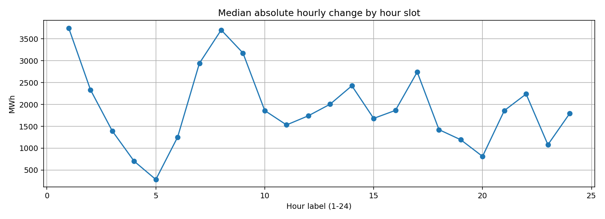

# Electricity Demand Analysis

**2025년 전국 전력수요 데이터 분석 및 1시간 후 수요 예측**

한국전력거래소(KPX)의 2025년 전국 시간별 전력수요 공공데이터를 활용해 시간대별·요일별 수요 패턴과 변동성, 피크 수요를 분석했습니다. 또한 평소와 다른 수요 패턴을 살펴보고, 머신러닝 모델을 비교해 1시간 후 전력수요를 예측했습니다.

**Tech Stack** · Python · Pandas · NumPy · Matplotlib · scikit-learn · Google Colab

[분석 코드 및 결과 확인](Electricity_Demand_Analysis.ipynb) · [데이터 출처(공공데이터포털)](https://www.data.go.kr/data/15065266/fileData.do)

## 프로젝트 배경

국립부경대학교 공학교육혁신센터의 비교과 프로그램 「수학 없이 시작하는 머신러닝의 이해와 구현」에서 학습한 내용을 실제 데이터에 적용해 보고자 프로젝트를 시작했습니다.

시간에 따른 변화가 뚜렷한 전력수요 공공데이터를 분석 대상으로 선정하여, 수요 패턴과 변동성을 살펴보고 머신러닝을 활용한 1시간 후 전력수요 예측을 진행했습니다.

## 주요 분석 결과

| 분석 항목 | 주요 결과 |
|:--|:--|
| 분석 범위 | **2025년 365일 · 8,760시간** |
| 월평균 수요가 가장 높은 달 | **8월** |
| 평균 수요가 가장 높은 시간대 | 원본 데이터의 **19시** 항목 |
| 상위 5% 수요 집중 | **8월 169시간**, 원본 데이터의 **17시·18시** 항목에서 각각 55시간으로 공동 최다 |
| 하루 중 최대·최소 수요 차이가 가장 큰 날 | **36,397 MWh** (2025-08-25) |
| 평일 / 주말 평균 수요 | **66,920.9 / 58,435.9 MWh** |
| 평소 패턴과 크게 다른 수요 | 10~12월 **2,208시간 중 0시간** (설정한 통계 기준) |
| 12월 최종 예측 | **Hist Gradient Boosting · MAE 736.574 MWh · R² 0.984** |

## 데이터 및 전처리

| 항목 | 내용 |
|:--|:--|
| 제공기관 | 한국전력거래소(KPX) |
| 데이터 | [시간별 전국 전력수요량](https://www.data.go.kr/data/15065266/fileData.do) |
| 기간 / 단위 | 2025-01-01 ~ 2025-12-31 / MWh |
| 원본 형식 | 날짜 열 + `1시`~`24시` 열, CP949 인코딩 |
| 전처리 | 빈 행 제거, 날짜·수요값 형식 정리, 결측·중복 확인, 시간별 행으로 재구성 |
| 검증 | 365일 × 24시간 = **8,760개 데이터** |

원본 수요값은 변경하지 않고, 날짜별로 구분된 시간대별 데이터를 시계열 분석에 적합한 형태로 정리했습니다.

## 분석 내용 및 시각화

### 01. 전력수요가 특히 높았던 시기와 하루 중 변화 폭


전체 8,760시간 중 전력수요 상위 5%(438시간)를 분석했습니다. 기준은 **82,947.2 MWh 이상**이며, **8월에 169시간**으로 가장 많이 나타났습니다. 또한 하루의 최대·최소 수요 차이를 계산해 일중 변동성을 확인했습니다.

### 02. 한 시간 사이 전력수요가 얼마나 변했을까?



한 시간 전과 비교한 수요 증감량을 계산하고, 시간대별 변화 크기를 비교했습니다. 이를 통해 수요가 빠르게 증가하거나 감소하는 구간을 살펴봤습니다.

### 03. 평소 같은 요일·시간대와 다른 수요가 있었을까?


**1~9월** 데이터를 기준으로 요일·시간대별 일반적인 수요 수준을 계산하고, **10~12월 2,208시간**의 수요와 비교했습니다.

중앙값과 MAD(중앙절대편차)를 활용한 통계 기준(`|robust_z| ≥ 3.5`)에서는 **0건**이 탐지되었습니다. 임계값을 2.0과 2.5로 조정하면 각각 49시간과 23시간이 탐지되었습니다.

탐지 결과는 임계값과 계절적 특성에 따라 달라질 수 있습니다.

### 04. 머신러닝을 활용한 1시간 후 수요 예측

#### 실험 설계

- **목표:** 과거 수요와 시간 정보를 활용한 1시간 후 전력수요 예측
- **입력 특성:** 직전 시간(`lag_1`), 전날 동일시간(`lag_24`), 일주일 전 동일시간(`lag_168`) 수요 및 시간·요일·월 정보
- **데이터 분할:** 1~9월 학습 → 10~11월 검증 → 12월 테스트
- **모델:** Ridge, Random Forest, Hist Gradient Boosting
- **평가 지표:** MAE, RMSE, R²

#### 10~11월 검증 결과

| 모델 | MAE (MWh) ↓ | RMSE (MWh) ↓ | R² ↑ |
|:--|--:|--:|--:|
| **Hist Gradient Boosting (선택)** | **915.340** | **1,198.679** | **0.974** |
| Random Forest | 944.624 | 1,284.963 | 0.970 |
| Ridge | 1,525.059 | 1,927.511 | 0.932 |
| 직전 시간 기준선 | 1,884.470 | 2,258.579 | 0.907 |
| 전일 동일시간 기준선 | 3,532.189 | 5,287.973 | 0.491 |

검증 기간의 MAE가 가장 낮은 **Hist Gradient Boosting**을 최종 모델로 선택했습니다.

#### 12월 최종 테스트 결과

| 모델 | MAE (MWh) ↓ | RMSE (MWh) ↓ | R² ↑ |
|:--|--:|--:|--:|
| 직전 시간 기준선 | 2,244.190 | 2,801.864 | 0.869 |
| 전일 동일시간 기준선 | 5,215.218 | 7,479.592 | 0.065 |
| Ridge | 1,718.885 | 2,325.862 | 0.910 |
| Random Forest | 889.285 | 1,175.096 | 0.977 |
| **Hist Gradient Boosting (선택)** | **736.574** | **968.827** | **0.984** |

12월 테스트에서 Hist Gradient Boosting 모델은 **MAE 736.574 MWh, R² 0.984**를 기록했습니다. 예측 시 직전 시간의 실제 수요를 활용하는 조건에서 평가했습니다.

### 05. 시간대에 따라 예측이 얼마나 정확했을까?


12월 데이터를 대상으로 Hist Gradient Boosting 모델과 직전 시간 수요를 활용한 기준선의 예측 오차를 비교했습니다. 시간대별 오차를 분석해 상대적으로 예측이 어려운 구간을 확인했습니다.

## 분석 결과 및 활용 방안

| 분석 항목 | 활용 방향 |
|:--|:--|
| 피크 수요 | 수요가 높은 달과 시간대 파악 |
| 시간별 수요 변화 | 수요가 빠르게 증가하거나 감소하는 구간 확인 |
| 이례 패턴 | 평소 같은 요일·시간대의 수요와 비교 |
| 예측 오차 | 예측이 잘 맞지 않는 시간대 확인 |

## 프로젝트 구조

```text
Electricity-Demand-Analysis/
├── README.md
├── Electricity_Demand_Analysis.ipynb
├── data/
│   └── kpx_hourly_demand_2025.csv
├── results/
│   ├── peak_volatility.png
│   ├── hourly_ramp.png
│   ├── context_deviation.png
│   ├── model_error_by_hour.png
│   ├── daily_operational_indicators.csv
│   ├── validation_model_comparison.csv
│   └── december_model_comparison.csv
├── requirements.txt
└── .gitignore
```

## 실행 방법 (Google Colab)

1. [분석 노트북](Electricity_Demand_Analysis.ipynb)을 Google Colab에서 엽니다.
2. Google Drive의 `MyDrive/Electricity-Demand-Analysis/data/` 폴더에 `kpx_hourly_demand_2025.csv`를 준비합니다.
3. 노트북에서 Google Drive 마운트를 승인합니다.
4. **런타임 → 모두 실행**을 선택합니다.

분석 결과는 `results/` 폴더에 저장됩니다. 필요한 패키지는 `requirements.txt`에서 확인할 수 있습니다.

## 분석의 한계 및 개선 방향

- **데이터 범위:** 2025년 전국 집계 데이터만 사용하여 지역별 차이나 장기 추세를 확인하기 어렵습니다.
- **외부 요인:** 기온, 공휴일 등 수요에 영향을 줄 수 있는 추가 변수를 반영하지 않았습니다.
- **이례 패턴 탐지:** 계절적 차이와 임계값 설정에 따라 탐지 결과가 달라질 수 있습니다.
- **수요 예측:** 직전 시간의 실제 수요를 활용하는 1시간 후 예측이며, 12월 데이터로 최종 평가했습니다.
- **시간 정보:** 원본 `1시`~`24시`의 정확한 집계 시간은 제공기관의 안내를 기준으로 확인해야 합니다.

**개선 방향:** 기상·공휴일 데이터 추가, 다년도 분석, 이례 패턴 탐지 기준 비교, 시각화 보완
